<a href="https://harshrastogi.au/">
  
</a>

I'm a data scientist in Darwin working on the Territory's environmental data: satellite Earth observation, spatial machine learning and ecological monitoring. I build each piece of work into something a land manager, a researcher or a council can use.

Right now I'm an Environmental Data Consultant with Landcare NT, which supports 32 volunteer Landcare groups from Darwin to Alice Springs. I map the land each group looks after, build the app for a multi-year vegetation survey, and set up acoustic monitoring with AudioMoth recorders.

I came to data science from finance: two years as a financial data analyst at WNS, reconciling up to a million payment transactions a day in SQL. I completed the coursework for a Master of Data Science at Charles Darwin University in October 2026, and I lead GovHack in the NT. I'm open to data science roles, and to project work with researchers, land managers and not-for-profits.

[harshrastogi.au](https://harshrastogi.au/) &nbsp;&nbsp; [About](https://harshrastogi.au/about) &nbsp;&nbsp; [Writing](https://harshrastogi.au/articles) &nbsp;&nbsp; [LinkedIn](https://www.linkedin.com/in/harshrastogii/) &nbsp;&nbsp; [contact@harshrastogi.au](mailto:contact@harshrastogi.au)

## Projects

Each image shows how the project works. Select one to open it.

  <a href="https://reachnt.vercel.app/">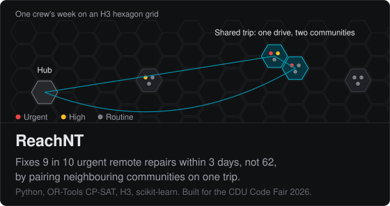</a>
  <a href="https://pyrantis.harshlabs.workers.dev/">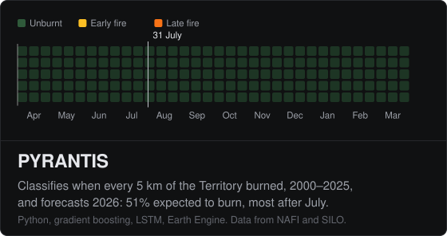</a>

  <a href="https://underlink-nt.vercel.app/"></a>
  <a href="https://harshrastogi.au/projects/gambawatch"></a>

  <a href="https://terraiq-nt.vercel.app/"></a>
  <a href="https://harshrastogi.au/projects/conflux">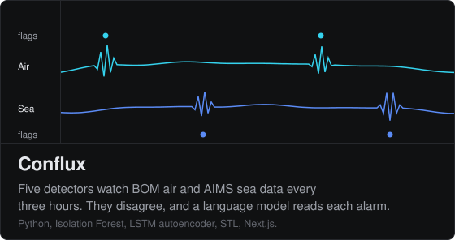</a>

  <a href="https://avianobservatory.vercel.app/">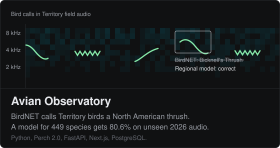</a>
  <a href="https://bushmetrics.vercel.app/">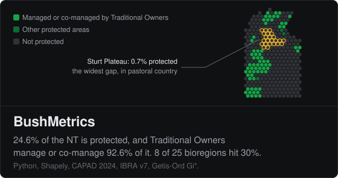</a>

  <a href="https://rainsignal.harshlabs.workers.dev/">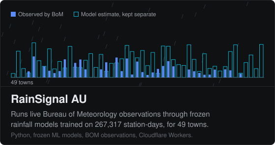</a>
  <a href="https://roadstate.harshrastogii.com"></a>

  
All projects, with what each one found

   

| Project | What it found | Links |
|---|---|---|
| **ReachNT** | Repair triage for remote NT public housing. Ranks repairs by need alone, pairs neighbouring communities on one trip using H3 hexagons, and tells each tenant why their repair waited. Across a synthetic year, 9 in 10 urgent remote repairs were fixed within 3 days instead of 62. CDU Code Fair 2026. | [Live site](https://reachnt.vercel.app/), [Code](https://github.com/harshrastogii/reachnt), [Write-up](https://harshrastogi.au/projects/reachnt) |
| **PYRANTIS** | Classifies every 5 km cell of the Territory as unburnt, early or late fire for each year from 2000 to 2025. Wet-season dryness, greenness and rain, not fire history, are the strongest predictors. The 2026 forecast: 51% expected to burn, most of it after July. | [Live site](https://pyrantis.harshlabs.workers.dev/), [Code](https://github.com/harshrastogii/PYRANTIS), [Talk](https://youtu.be/c_0yCsdZX2U), [Write-up](https://harshrastogi.au/projects/pyrantis) |
| **Underlink** | A coverage map shows a signal, not what it depends on. 18 of 23 remote places that reach fibre by radio rely on a relay with no other licensed path. About 7,100 people live in those 18 places. CDU Code Fair 2026. | [Live site](https://underlink-nt.vercel.app/), [Code](https://github.com/harshrastogii/underlink-nt), [Write-up](https://harshrastogi.au/projects/underlink) |
| **GambaWatch NT** | A 20 m map of where invasive gamba grass is likely across Darwin and Litchfield, from Sentinel-1, Sentinel-2 and MODIS in Earth Engine. It scored 0.86 AUC against presence records, but tested on 27,469 recorded absences from the Weed Management Branch it barely separates gamba from no gamba (AUC 0.54). It maps gamba country, not the grass, so the claims were restated and the next version trains on those absences. | [Write-up](https://harshrastogi.au/projects/gambawatch). Research in progress |
| **TerraIQ** | A Territory-wide weather memory from 44 BOM stations, holding what the public feed drops after 72 hours. Its fire-weather score looked useful over the whole record, but fell to near chance within the same month; fuel age predicted fire far better. | [Live site](https://terraiq-nt.vercel.app/), [Write-up](https://harshrastogi.au/projects/terraiq) |
| **Conflux** | Weather and sea on one clock: BOM stations across the Territory and AIMS sensors off Darwin, checked every three hours by five detectors. They disagree, and the dashboard says so. A language model reads each alarm and says whether it looks like a broken sensor or real weather. | [Write-up](https://harshrastogi.au/projects/conflux). Dashboard private until the paper is published |
| **Avian Observatory** | My master's thesis. On Territory audio, BirdNET confidently answers Bicknell's Thrush, a bird of the north-eastern US. A model for 449 Territory species, built on Perch 2.0, names the right bird 80.6% of the time on 537 recordings from 2026, against 65.7% for BirdNET. | [Live site](https://avianobservatory.vercel.app/), [Write-up](https://harshrastogi.au/projects/avian-observatory) |
| **BushMetrics** | 24.6% of the NT is protected, and Traditional Owners manage or co-manage 92.6% of it. 8 of 25 bioregions meet the 30% target; the gaps run through the pastoral middle, down to 0.7% on the Sturt Plateau. Version 2 corrects my first version, which missed Indigenous Protected Areas. | [Live site](https://bushmetrics.vercel.app/), [Code](https://github.com/harshrastogii/bushmetrics), [Write-up](https://harshrastogi.au/projects/bushmetrics) |
| **RainSignal AU** | Live BoM observations run through frozen rainfall models trained on 267,317 station-days for 49 towns. An observation and an estimate are never shown as the same thing, and stale data is labelled stale. | [Live site](https://rainsignal.harshlabs.workers.dev/), [Code](https://github.com/harshrastogii/rainsignal-au), [Write-up](https://harshrastogi.au/projects/rainsignal) |
| **RoadState** | The Territory's road problem is seasonal access, not congestion: 78% of traffic is in Darwin and 66% of the year's closures begin in the wet. | [Live site](https://roadstate.harshrastogii.com), [Code](https://github.com/harshrastogii/RoadState) |
| **NT Crime Intelligence** | Switching from raw counts to per-capita rates reorders which communities are most affected. Ships a clean 2008–2026 public dataset. | [Live site](https://harshrastogii-nt-crime-dashboard.hf.space/), [Code](https://github.com/harshrastogii/nt-crime-dashboard) |
| **Gradaroo** | An AI career platform for Australian students and graduates: live jobs, who hires from each of 40 universities, resume and cover-letter tools, and Roo, a voice assistant. AI output is checked by code, not taken on trust. | [Live site](https://gradaroo.com.au) |
| **Biodiversity Surrogate Validation** | A pre-registered test of open spatial surrogates against expert assessment. Vegetation-type rarity won, but only modestly: these are screens, not substitutes. | [Code](https://github.com/harshrastogii/biodiversity-surrogate-validation) |
| **NT Conservation Exposure** | An open-data conservation exposure index for the whole Territory, tested against expert assessment of the Roper River. Agreement was weak, and it came from land convertibility, not biodiversity. | [Code](https://github.com/harshrastogii/nt-conservation-exposure) |
| **ArmaWatch** | A mobile-friendly rebuild of Wage Peace's map of 127 Australian weapons-industry sites, with filters, summaries and CSV export. | [Live site](https://armawatch.vercel.app/), [Code](https://github.com/harshrastogii/ArmaWatch) |
| **Australian Charities Analytics** | Descriptive, predictive and diagnostic analysis of the ACNC Charity Register, for a CDU unit. | [Code](https://github.com/harshrastogii/PRT564-Group2-CharityAnalysis) |
| **Student Central RAG** | Answers student questions from official CDU content with citations, and drafts an escalation email when it can't answer confidently. | In progress |
| **harshrastogi.au** | My portfolio and writing. A static site with no framework. | [Live site](https://harshrastogi.au/), [Code](https://github.com/harshrastogii/portfolio) |

## Experience

**Environmental Data Consultant (contract)**, Landcare NT, Darwin. Oct 2026 to present

- Built one data structure for the boundaries of all 32 Landcare groups: a GDA2020 GeoPackage master and a reproducible Python and GeoPandas pipeline that exports shapefiles, KMZ, GeoJSON for Firemapper and A3 maps. Delivering the six-group pilot, including Alice Springs Landcare and Friends of East Point.
- Building the KoboToolbox app for a multi-year vegetation survey of about 380 plots across four Darwin catchments, replacing paper datasheets, with every field mapped to the NT Government Vegetation Site Database.
- Set the standard configuration for 16 AudioMoth acoustic recorders and am writing the volunteer guide; presenting them at the Tools for Monitoring Wildlife Workshop in December 2026.

**Data and Operations Analyst (industry placement)**, Charles Darwin University, Faculty of Arts and Society. Jun to Jul 2026

- Built a travel and finance analytics platform: a one-click Python pipeline from the Snapforms API and travel-agency records into Parquet bronze, silver and gold layers, feeding a Power BI dashboard with budget-versus-actual views for every department.
- Designed an AI-assisted tool that turns plain-language requirements into Snapforms forms, backed by a PostgreSQL quality-assurance engine, and migrated workforce data across HR exports with an audit-ready matching report.

**Data Analytics Instructor (contract)**, CDU Information Technology Student Association. May to Jul 2025

- Designed and taught Data Bytes, a four-part workshop series in Excel, Power Query, Power Apps and Power BI on NT Government open data. Recognised by the Vice-Chancellor in all-staff communications.

**Financial Data Analyst**, WNS Global Services, Gurugram, India. Sep 2022 to Nov 2024

- Reconciled payment data in SQL for Payoneer's Global Payment Transfer process: 100,000 to over 1,000,000 transactions a day that automatic matching couldn't clear, matched across source systems, bank data and ledgers.
- Traced 100 to 200 unidentified suspense-account transactions a day through global bank portals, including Citibank branches in several countries, decoding inconsistent references so each item could be cleared.
- Built Power BI reports and dashboards for management, designed quality-control checks that reduced processing errors, and coordinated the daily workflow of a 15-person team. Promoted from Associate to Senior Associate, Operations, in April 2024.

**Customer Service Coordinator and Residential Advisor**, UniLodge, Darwin. Feb 2025 to May 2026

- First point of contact for a large student community, including after-hours emergencies. On the Spot Award for leadership during Severe Tropical Cyclone Fina.

## Education

**Master of Data Science**, Charles Darwin University. Coursework completed October 2026. My research thesis on acoustic classification of Territory birds became Avian Observatory.

**Bachelor of Commerce**, University of Delhi, 2019 to 2022. First Division.

## Leadership and community

- **Northern Territory Lead, GovHack** (Aug 2025 to present). I run GovHack in the Territory: partnerships, sponsorship, volunteers and connecting participants with public datasets.
- **Council Member, Multicultural Youth Council of the NT** (Oct 2026 to present), representing multicultural, migrant and refugee young people across the Territory.
- **Invasive Species Surveillance Volunteer**, CDU Research Institute for the Environment and Livelihoods (Sep 2026 to present), on the Eurasian Tree Sparrow eradication program.
- **President, CDU Information Technology Student Association** (Jul 2025 to Jul 2026).
- Student representative on CDU's Learning and Teaching Committee, Your Voice Student Network, and the Indian Student Forum executive; Senior Buddy Mentor for new international students.

## How I work

- I start from the decision the analysis is meant to inform, then go looking for data.
- I test models on data they haven't seen, and go after the reference data needed to measure accuracy properly. GambaWatch's absences test is the latest example.
- I report what the data doesn't support, and correct my own work in public. BushMetrics version 1 missed Indigenous Protected Areas, so I withdrew its figures. Avian Observatory's early 92.7% came from a leaky split, so it's never quoted.
- I build things that keep running on their own: scheduled pipelines, no servers to look after.

## Tools

- **Remote sensing:** Google Earth Engine, Sentinel-1 radar, Sentinel-2 and MODIS time series, NAFI burnt-area and hotspot archives.
- **Machine learning:** gradient boosting, random forests, LSTMs, deep-learning audio classifiers, spatial and temporal cross-validation, calibration checks.
- **Spatial:** GeoPandas, GDAL, QGIS and PyQGIS, H3, GDA2020, with delivery as GeoPackage, shapefile, KMZ and GeoJSON.
- **Field monitoring:** AudioMoth acoustic recorders, KoboToolbox and XLSForm.
- **Engineering:** Python, SQL and PostgreSQL, FastAPI, Docker, GitHub Actions, React, MapLibre GL, Power BI and AWS.

## Contributions


Redrawn every day from my GitHub contribution calendar by <a href="./.github/workflows/field-signal.yml">a scheduled workflow</a>.

If you have Territory data that isn't being used yet, email me at [contact@harshrastogi.au](mailto:contact@harshrastogi.au).
